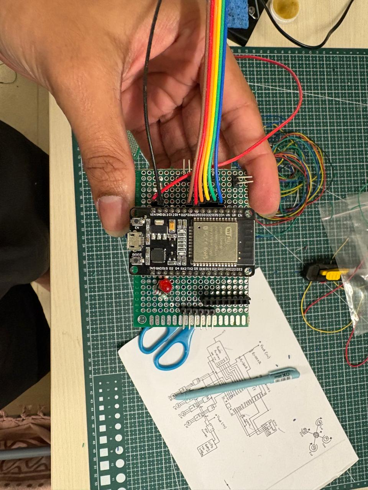
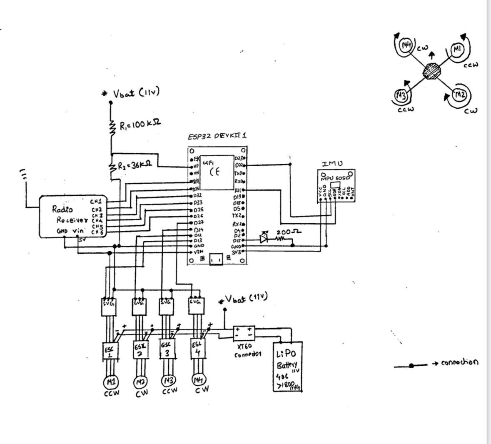
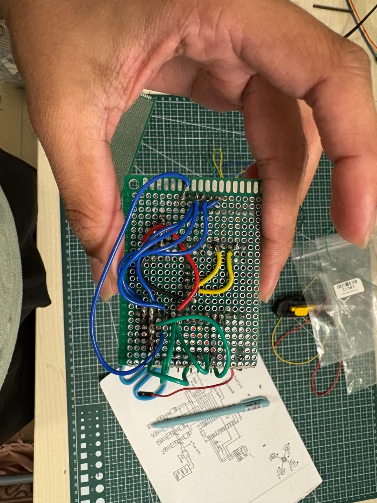

# Pegasus — ESP32 flight controller hardware prototype

A perfboard prototype for Team Pegasus, built around an ESP32 DevKit. This repository documents the hardware design and assembly through the wiring schematic and front/back photographs.

## Hardware architecture

| Block | Connection shown in the schematic |
| --- | --- |
| ESP32 DevKit | Central controller and signal routing |
| MPU6050 IMU | I²C connection to the ESP32, with shared power and ground |
| Six-channel radio receiver | Receiver channels routed to ESP32 inputs |
| Four ESCs and brushless motors | Four ESP32 control outputs routed through ESC connectors; ESCs drive the motors |
| 11 V LiPo battery | Power source for the ESCs; a 100 kΩ / 36 kΩ divider samples battery voltage at an ESP32 analog input |
| Status LED | ESP32 output with a series resistor |

The drawing labels alternating motor rotation directions (M1/M3 counterclockwise, M2/M4 clockwise). Refer to the original schematic before reproducing any pin assignment or power connection; the photographs are documentation of a hand-wired prototype, not an assembly specification.

## Design and build record

- [Hand-drawn wiring schematic](wiring-schematic.png)
- [Component-side photograph](prototype-front.png)
- [Solder-side photograph](prototype-back.png)

## Scope

This repo records the hardware prototype: schematic planning, ESP32 and peripheral wiring, and perfboard assembly. It does not include flight firmware, a fabricated PCB layout, or flight-test results.
